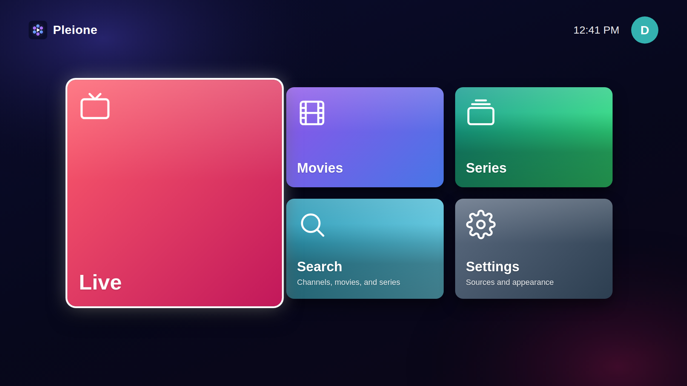
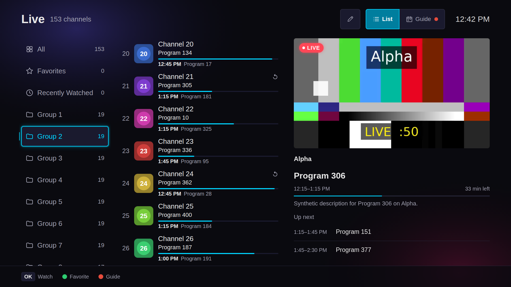
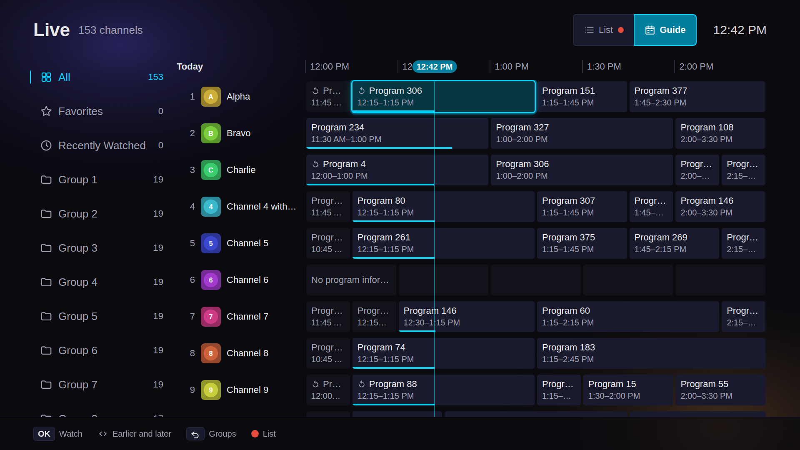
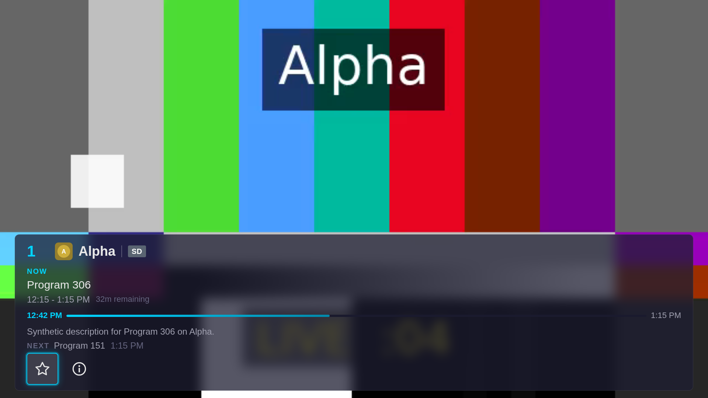
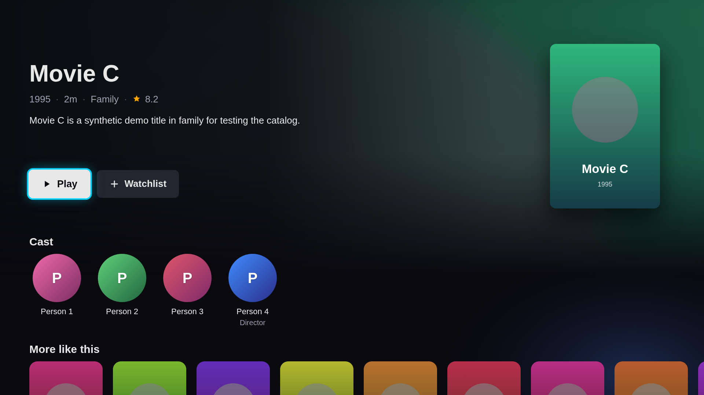
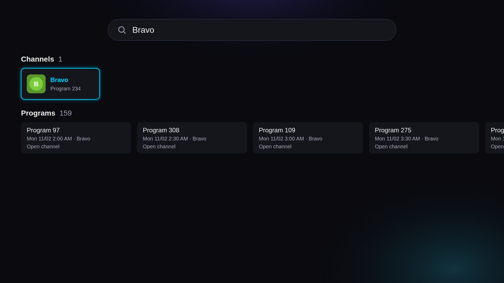

<div align="center">
  
  <h1>Pleione</h1>
  <p><strong>A free IPTV player for your own M3U playlists and Xtream accounts, made for the remote.</strong></p>
  <p>
  <a href="#supported-webos-versions"></a>
  <a href="https://github.com/ahmedsaed/pleione/releases/latest"></a>
  <a href="https://github.com/ahmedsaed/pleione/releases"></a>
  <a href="LICENSE"></a>
  </p>
  <p><a href="https://pleione.merope.dev/">Website</a> · <a href="https://pleione.merope.dev/setup/">Setup guide</a> · <a href="https://pleione.merope.dev/support/">Support</a> · <a href="https://pleione.merope.dev/privacy/">Privacy</a></p>
</div>

Pleione plays the IPTV service you already have on your LG webOS TV: live TV
with a program guide and catch-up, movies and series, all laid out for the
remote. It runs on **webOS 4.0 (2018) and newer**.

Pleione does not include any channels, playlists, or content. You add a
playlist or an account from a provider of your own, and you are responsible
for having the right to watch it.

| Home | Live |
| --- | --- |
|  |  |
| **Guide** | **Player** |
|  |  |
| **Movie detail** | **Search** |
|  |  |

## Highlights

**Live TV**
- M3U/M3U8 playlists and Xtream Codes accounts, several at once
- A program guide (XMLTV) found from your playlist or added by hand, with
  per-source time correction
- Catch-up for programs that already aired, and pause and rewind where the
  stream allows it
- A live preview beside the channel list, favorites, Recently Watched,
  number-key tuning, and reminders that fire even with the app closed

**Movies and Series** (Xtream accounts)
- Browse by category, sorted by name, date added, rating, or year
- Detail pages with plot, cast, rating, seasons, and episodes
- Continue Watching and a Watchlist; episodes play on into the next one

**Search**
- One search across channels, guide programs, movies, and series
- Arabic-aware matching that ignores differences in hamza, final letters,
  diacritics, and digits

**Playback**
- Streams go straight to the TV's own player, so HDR10, HLG, Dolby Vision®,
  and Dolby Atmos® pass through ([why native](docs/native-vs-hls.js.md))
- HLS, MPEG-TS, and MPEG-DASH, including PlayReady, Widevine, and ClearKey
  protected streams ([details](docs/mpeg-dash.md))
- Audio and subtitle tracks, remembered per channel and per title, plus
  optional online subtitle search
- Automatic recovery from streams that fail to start or stall

**Make it yours**
- 12 languages, with a fully mirrored layout for Arabic: English, العربية,
  Deutsch, Español, Français, Italiano, Polski, Português (Brasil), Русский,
  Türkçe, Українська, and 简体中文
- Interface size from 90% to 130% and text size from 80% to 150%
- Light and dark color themes
- Parental controls with a PIN for groups, categories, or single titles
- Full D-pad and Magic Remote support

**Set up from your phone**
- Scan the QR code on the TV, enter the pairing code, and type your account
  details or upload an `.m3u` file on your phone instead of the remote. It
  works on your home network, only while Pleione is open
  ([how it works](docs/lan-service.md)).

**Private**
- No account, no analytics, no ads. Your accounts and history stay on the
  TV, and Pleione talks only to your own providers and the optional
  services you turn on.

Some things webOS does not allow, or that are out of scope, are listed in
[unsupported features](docs/unsupported-features.md).

## Install

- **LG Content Store** — coming soon. Once listed, search for **Pleione** on
  your TV.
- **Developer Mode** — download the latest `.ipk` from
  [Releases](https://github.com/ahmedsaed/pleione/releases/latest)
  and install it with the
  [webOS CLI](https://webostv.developer.lge.com/develop/tools/cli-installation):

  ```bash
  npm install -g @webos-tools/cli
  ares-setup-device --add tv -i "username=prisoner" -i "host=<TV IP>" -i "port=9922"
  ares-novacom --device tv --getkey     # enter the passphrase Developer Mode shows
  ares-install --device tv ./com.merope.pleione_<version>_all.ipk
  ```

  A Developer Mode session expires unless you renew it in the Developer Mode
  app, and the TV then removes sideloaded apps.
- **Homebrew Channel** (rooted TVs) — add this repository to Homebrew
  Channel:
  `https://raw.githubusercontent.com/ahmedsaed/pleione/pleione/homebrew-repository.json`

The [setup guide](https://pleione.merope.dev/setup/) walks through every
step, adding your first account or playlist, and finding your way around
with the remote.

## Supported webOS versions

The baseline is the Chromium 53 engine on webOS 4; every later release ships
a newer Chromium, so the app is forward-compatible. Features only newer
engines support natively get feature-detected fallbacks on older ones.

| webOS version | Released | Chromium engine | Bundled service Node.js | Supported |
| --- | --- | --- | --- | --- |
| webOS 4.x | 2018–2019 | 53 | 0.12.2 | ✅ (minimum) |
| webOS 5.0 | 2020 | 68 | 8.12.0 | ✅ |
| webOS 6.0 | 2021 | 79 | 8.12.0 | ✅ |
| webOS 22 | 2022 | 87 | 12.21.0 | ✅ |
| webOS 23 | 2023 | 94 | 12.22.2 | ✅ |
| webOS 24 | 2024 | 108 | 16.19.1 | ✅ |
| webOS 25 | 2025 | 120 | 16.20.2 | ✅ |
| webOS 26 | 2026 | 132 | 20.12.2 | ✅ |

webOS 3.x and older are not supported.

## Development

Pleione is vanilla TypeScript bundled with esbuild, plus a small bundled
webOS service for phone setup. You need [Node.js](https://nodejs.org/) 22+,
and the webOS CLI to package or install on a TV.

```bash
npm install
npm run preview          # build and serve at http://localhost:3000
npm test                 # unit and integration tests
npm run lint             # Chromium 53 compatibility gate
npm run test:e2e         # Playwright, including a Chromium 53 simulation
npm run xtream:demo      # local demo Xtream server (needs ffmpeg)
./build.sh               # package the .ipk
./build.sh --install     # package, install, and cold-restart on the default TV
```

The desktop preview plays through hls.js, mpegts.js, and Shaka; on the TV
everything plays natively. `scripts/tv.sh` streams logs, evaluates code,
captures screenshots, sends remote keys, and collects a redacted diagnostics
report from a TV in Developer Mode (usage is at the top of
`scripts/tv.sh`).

Read [AGENTS.md](AGENTS.md) for the architecture, conventions, and webOS
gotchas, and [CONTRIBUTING.md](CONTRIBUTING.md) before opening a pull
request.

### Docs

- [Native playback vs. hls.js](docs/native-vs-hls.js.md)
- [Audio track selection](docs/audio-track-selection.md)
- [HLS subtitles](docs/hls-subtitles.md)
- [VOD subtitles](docs/vod-subtitles.md)
- [MPEG-DASH](docs/mpeg-dash.md)
- [Storage and data](docs/storage-and-data.md)
- [LAN setup service](docs/lan-service.md)
- [Right-to-left layout](docs/rtl-layout.md)
- [Demo Xtream server](docs/xtream-demo-server.md)
- [Unsupported features](docs/unsupported-features.md)

## Credits and license

Pleione is made by Merope and licensed under [Apache-2.0](LICENSE). It
started as a fork of
[webOS IPTV Player](https://github.com/lennylxx/webos-iptv-player) by
lennylxx; see [NOTICE](NOTICE).

Third-party software and artwork keep their own licenses, listed in
[THIRD_PARTY_NOTICES.txt](THIRD_PARTY_NOTICES.txt). Every build ships
`LICENSE`, `NOTICE`, `THIRD_PARTY_NOTICES.txt`, and `licenses/` inside the
package.
